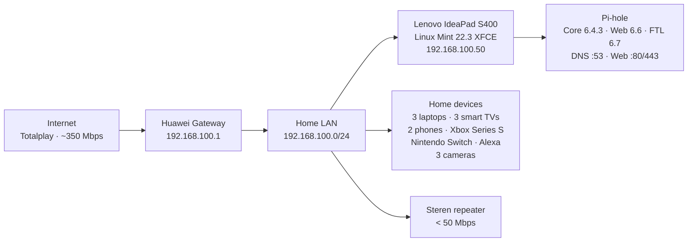

# Home Lab — Linux, Pi-hole & Home Networking

> **Status: ⏸️ Paused / Offline.** The server laptop is currently disconnected and powered off. This repo documents what was built, what was tested, what went wrong, and what is planned next — nothing here claims a service is running today.

A home lab built to learn networks, Linux server administration, DNS/DHCP, and self-hosted services, using a repurposed laptop as a home server.

## Overview

In September 2026 I repurposed an old Lenovo IdeaPad S400 as a Linux home server. The main service was **Pi-hole**, a network-wide DNS filter for the devices in my house. The lab was a learning project: understand how DNS, DHCP, and home connectivity actually work, instead of only reading about them.

## Status at a glance

| Item | Status | Notes |
| --- | --- | --- |
| Lenovo server (Linux Mint 22.3 XFCE) | ⏸️ Paused | Laptop disconnected and powered off since fall 2026 |
| Pi-hole (Core 6.4.3 / Web 6.6 / FTL 6.7) | ✅ Implemented & tested (Sep 2026) | DNS on port 53, dashboard on 80/443, worked for home devices |
| DNS filtering for home devices | ✅ Tested (Sep 2026) | Pi-hole served as the DNS filter on the home LAN |
| NAS / network storage | 📋 Planned | Not built yet |
| Remote access | 📋 Planned / ❓ Unresolved | Tailscale caused a DNS conflict (see incident below) |
| Local AI services | 📋 Planned | Not started |
| Connection problems after the Tailscale incident | ❓ Unresolved | Root cause not fully diagnosed; lab paused instead |

## Architecture

## Hardware

| Device | Details |
| --- | --- |
| Server | Lenovo IdeaPad S400 (repurposed laptop) |
| Hostname | `diegoegogogo-Lenovo-IdeaPad-S400` |
| OS | Linux Mint 22.3 XFCE |
| RAM | 4 GB |
| Internal disk | WD3200BPVT, 320 GB, 5400 rpm |
| External disk | 500 GB |
| Battery | 0% — requires continuous power |
| Ethernet (`enp1s0`) | `192.168.100.50/24` |
| Wi-Fi (`wlp2s0`) | `192.168.100.236/24` |

## Network

| Item | Details |
| --- | --- |
| ISP | Totalplay, \~350 Mbps plan |
| Gateway / router | Huawei, `192.168.100.1` |
| LAN | `192.168.100.0/24` |
| Server (Ethernet) | `192.168.100.50` |
| Server (Wi-Fi) | `192.168.100.236` |
| Home devices | 3 laptops, 3 smart TVs, 2 phones, Xbox Series S, Nintendo Switch, Alexa, 3 cameras |
| Repeater | Steren repeater, delivered < 50 Mbps (candidate to remove) |
| Switch | None at the time of writing |

> All addresses above are private LAN addresses (`192.168.100.0/24`). No public IPs, passwords, or secrets are published in this repo.

## Services

### Pi-hole — network-wide DNS filtering

- **Versions (Sep 2026):** Core 6.4.3, Web 6.6, FTL 6.7 (FTL 6.7.1 was already available as an update at the time).
- **DNS:** port 53. **Web dashboard:** ports 80 and 443.
- **What it did:** filtered DNS queries for the devices on the home LAN.
- **Verified working:** FTL active, dashboard accessible, DNS resolving through Pi-hole (September 2026).

## What was tested and worked

- Linux Mint installed and running as a server OS on repurposed hardware.
- Pi-hole installed, FTL active, dashboard reachable from the LAN.
- Home devices using Pi-hole as their DNS filter.
- Server reachable on the LAN at `192.168.100.50` (Ethernet).

## Incident: Tailscale DNS conflict

- **What happened:** Tailscale set the nameserver to `100.100.100.100` and changed DNS resolution, which caused connectivity problems on other devices in the house.
- **What I did:** disabled Tailscale. After continued connection problems, I paused Pi-hole and disconnected the laptop.
- **Current state:** the lab is offline. The exact root cause of the connection problems was not fully diagnosed, and whether Tailscale is still installed/configured is unknown. This is documented as unresolved, not as fixed.

## Lessons learned

- A VPN that overrides DNS can break name resolution for an entire home network — DNS changes need to be tested device by device.
- A repurposed laptop works as a home server, but a dead battery (0%) means any power cut takes the whole lab down.
- Document the working state *while* it works: versions, IPs, and ports are much harder to reconstruct after the machine is off.
- Pausing and documenting honestly beats pretending a paused project is still running.

## Roadmap

- [ ] Bring the server back online and re-verify Pi-hole (Core/FTL versions, DNS, dashboard).
- [ ] Diagnose the connection problems properly before re-enabling DNS filtering for all devices.
- [ ] Revisit remote access carefully (Tailscale or an alternative), with DNS behavior tested first.
- [ ] Set up NAS / network storage using the 500 GB external disk.
- [ ] Remove or replace the Steren repeater (< 50 Mbps).
- [ ] Explore local AI services on the lab (planned, not started).
- [ ] Add sanitized screenshots of the Pi-hole dashboard (no public IPs or secrets).

## How it was set up

High-level, from what was actually done in September 2026:

1. Installed Linux Mint 22.3 XFCE on the Lenovo IdeaPad S400.
2. Installed Pi-hole on the server (DNS on port 53, web dashboard on 80/443).
3. Pointed home devices / the LAN DNS to the server at `192.168.100.50`.

No step-by-step install commands are claimed here beyond what was done — the focus of this repo is the documented state of the lab, not a copy-paste tutorial.

## Screenshots

None yet — the server is offline. Dashboard screenshots will be added (sanitized) once the lab is back online.

## Author

Diego Garibay Méndez — AI & Data Science student (UdeG, CUGDL)

- GitHub: https://github.com/diegoegogogo
